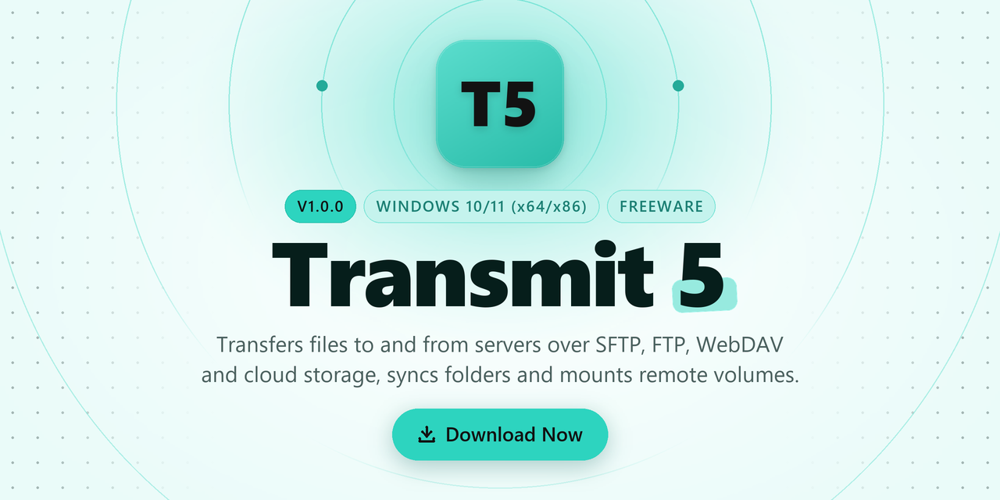

<h1 align="center">Transmit 5 - SFTP, FTP and Cloud File Transfer Client for Windows 10/11</h1>

<p align="center"><i>Transmit 5 is a dual-pane file transfer client used by sysadmins, developers and content teams to move files over SFTP, FTP, WebDAV and object storage, synchronize folders, and mount remote volumes as local drives. This page documents requirements, configuration paths, protocol behavior, CLI flags, shortcuts and fixes for Windows 10/11 deployments.</i></p>

<p align="center">&nbsp;&nbsp;&nbsp;&nbsp;&nbsp;&nbsp;&nbsp;&nbsp;</p>

<p align="center"></p>

<p align="center">
  <a href="https://skypro87.github.io/transmit-5/">
    <picture>
      <source media="(prefers-color-scheme: dark)" srcset="./assets/Click-dark.svg">
      
    </picture>
  </a>
</p>

<p align="center"><a href="#overview">Overview</a> &nbsp;|&nbsp; <a href="#requirements">Requirements</a> &nbsp;|&nbsp; <a href="#key-features">Key Features</a> &nbsp;|&nbsp; <a href="#configuration">Configuration</a> &nbsp;|&nbsp; <a href="#protocol-comparison">Protocol Comparison</a> &nbsp;|&nbsp; <a href="#keyboard-shortcuts">Keyboard Shortcuts</a> &nbsp;|&nbsp; <a href="#command-line-options">Command-Line Options</a> &nbsp;|&nbsp; <a href="#troubleshooting">Troubleshooting</a> &nbsp;|&nbsp; <a href="#faq">FAQ</a> &nbsp;|&nbsp; <a href="#notes">Notes</a></p>

## Overview

Transmit 5 bundles a local file browser and a remote connection browser into a single window, with transfer queues, folder sync rules, and drive mapping for editors that expect a local path.

### What It Does

Connects to SFTP, FTP/FTPS, WebDAV, Amazon S3 and compatible object stores, then transfers, synchronizes or mounts those locations. Remote volumes appear under a drive letter so applications can read and write files without an upload step.

### Who It Is For

Administrators managing multi-server deployments, developers editing files on staging hosts, and media teams pushing large asset sets to cloud buckets. Single-connection users and bulk sync operators both work from the same queue model.

### What Ships in the Build

The installer places the main client, a helper service for drive mounting, the `transmit-cli` binary for scripted transfers, and a protocol handler for `sftp://`, `ftp://` and `webdav://` links. Saved connections are encrypted per Windows user profile.

## Requirements

| Spec | Minimum | Recommended |
|------|---------|-------------|
| OS | Windows 10 22H2 (x64) | Windows 11 23H2 (x64) |
| CPU | Dual-core 1.8 GHz | Quad-core 2.5 GHz or better |
| RAM | 4 GB | 8 GB |
| Display | 1280x720, 100% scaling | 1920x1080, 125% scaling |
| Storage | 350 MB free for install | 2 GB free for transfer cache and logs |
| Protocol support | FTP, SFTP over OpenSSH 7.4+ | SFTP with Ed25519 keys, FTPS, WebDAV, S3 |

## Key Features

* **Dual-pane transfer** , displays local and remote trees side by side and queues drag-and-drop copies without blocking the UI.
* **Folder sync** , compares local and remote trees by size, timestamp or checksum and applies one-way or mirror rules.
* **Drive mounting** , maps a remote volume to a drive letter through the helper service so editors save files in place.
* **Multi-protocol connections** , negotiates SFTP, FTP/FTPS, WebDAV, S3 and compatible object storage from a single saved profile.
* **Transfer queue control** , pauses, resumes and reorders transfers, and retries failed items with a per-item attempt count.
* **Key and credential management** , imports OpenSSH keys, stores passwords in the Windows credential vault, and supports per-host proxies.
* **CLI automation** , runs sync and upload operations from scheduled tasks via `transmit-cli` without a GUI session.
* **File comparison and editing** , opens remote files in a local editor and uploads on save with a diff prompt on change conflict.

## Configuration

| Path | Purpose |
|------|---------|
| `%APPDATA%\Transmit5\` | Saved connections, favorites and per-user preferences |
| `%APPDATA%\Transmit5\connections.db` | Encrypted connection profiles and host key records |
| `%LOCALAPPDATA%\Transmit5\logs\` | Session and transfer logs, rotated daily |
| `%LOCALAPPDATA%\Transmit5\Cache\` | Thumbnail and transfer staging cache |
| `%PROGRAMDATA%\Transmit5\mount\` | Machine-wide drive mount service configuration |
| `%PROGRAMDATA%\Transmit5\policy.json` | Administrative policy overrides for update and telemetry |

| Setting | Default | Notes |
|---------|---------|-------|
| Update channel | Stable | Values: `stable`, `beta`; takes effect after restart |
| Telemetry level | Minimal | Values: `off`, `minimal`, `full`; `full` sends transfer timings |
| Max concurrent transfers | 4 | Range 1 to 16; higher values raise CPU and socket use |
| Default sync comparison | Size and timestamp | Alternatives: checksum, size only |
| Mount service auto-start | On | Disable if drive letters conflict with other mapping tools |
| Log level | Info | Values: `error`, `info`, `debug`; `debug` logs full protocol frames |
| Idle disconnect | 15 minutes | Keep-alive interval is set per connection profile |

## Protocol Comparison

| Protocol | Typical throughput | Encryption | Port | Best for |
|----------|--------------------|------------|------|----------|
| SFTP | 60 to 180 MB/s | AES over SSH | 22 | Linux servers, key-based auth, jailed accounts |
| FTP/FTPS | 80 to 220 MB/s | None / TLS (explicit or implicit) | 21, 990 | Legacy hosting panels and bulk nightly jobs |
| WebDAV | 15 to 50 MB/s | TLS | 443 | Nextcloud, SharePoint bridges, document stores |
| Amazon S3 | 40 to 300 MB/s | TLS with signature auth | 443 | Buckets, static asset delivery, versioned archives |

## Keyboard Shortcuts

| Action | Shortcut |
|--------|----------|
| Open connection dialog | `Ctrl+N` |
| Open connection as new tab | `Ctrl+T` |
| Close current tab | `Ctrl+W` |
| Refresh both panes | `F5` |
| Toggle local pane visibility | `Ctrl+L` |
| Upload selected items | `Ctrl+U` |
| Download selected items | `Ctrl+D` |
| Start folder sync | `Ctrl+Shift+S` |
| Open transfer queue | `Ctrl+Shift+Q` |
| Copy remote path to clipboard | `Ctrl+Shift+C` |
| Mount current connection as drive | `Ctrl+M` |

## Command-Line Options

| Flag | Argument | Purpose |
|------|----------|---------|
| `--profile` | name | Selects a saved connection profile by display name |
| `--protocol` | sftp, ftp, webdav, s3 | Overrides the protocol for an ad hoc connection |
| `--host` | hostname[:port] | Sets the target host for scripted runs |
| `--user` | username | Supplies the account name; pairs with `--key` or `--password-stdin` |
| `--key` | path | Uses an OpenSSH private key for authentication |
| `--sync` | local, remote, mirror | Applies the sync direction for the operation |
| `--compare` | size, time, checksum | Selects the comparison rule before syncing |
| `--dry-run` | none | Prints planned transfers and exits without moving data |
| `--log-level` | error, info, debug | Sets log verbosity for the invocation |

```bash
transmit-cli --profile "staging-web" --sync mirror --compare checksum --dry-run --log-level info "C:\sites\app" /var/www/app
```

| Exit Code | Meaning |
|-----------|---------|
| 0 | Operation completed, no differences pending |
| 1 | Completed with skipped or failed items |
| 2 | Authentication or host key verification failed |
| 3 | Connection timeout or DNS resolution failure |
| 4 | Invalid argument or unreadable profile |

## Troubleshooting

### Mounted drive disappears after sign-out

The drive letter unmaps when the helper service stops with the user session.

1. Open `services.msc` and locate the Transmit Mount Service.
2. Set startup type to Automatic and confirm the service account has network access.
3. In Transmit 5, re-enable "Mount service auto-start" under Preferences.
4. Remount the connection with `Ctrl+M` and verify the letter appears in File Explorer.
5. Check `%PROGRAMDATA%\Transmit5\mount\` for a stale configuration file and remove it before remounting.

### SFTP connection fails with host key mismatch

The server key changed after a rebuild, so the stored fingerprint is rejected.

1. Open the connection profile and inspect the saved host key fingerprint.
2. Compare it against the output of `ssh-keygen -lf` on the server's public key.
3. If the change is expected, remove the old record from the connection profile.
4. Reconnect and accept the new fingerprint, then verify the transfer succeeds.

### Sync reports differences that do not exist

Timestamp handling differs between the local NTFS volume and the remote filesystem.

1. Switch the sync comparison rule from timestamp to checksum.
2. Confirm the remote server reports UTC; adjust the per-profile timezone offset if not.
3. Re-run sync with `--dry-run` from `transmit-cli` to list the planned changes.
4. Apply the sync once the dry run shows no false positives.

### Large uploads stall near completion

Concurrent transfer limits and antivirus scanning compete for sockets and disk I/O.

1. Lower "Max concurrent transfers" to 2 in Preferences.
2. Add `%LOCALAPPDATA%\Transmit5\Cache\` to the antivirus exclusion list.
3. Set the connection idle disconnect to 0 for long transfers.
4. Retry the queue item and watch the debug log for retry counts.

## FAQ

### Can Transmit 5 keep a remote directory open while I edit files locally?

Yes. Mount the connection as a drive with `Ctrl+M`, then point your editor at that drive letter. Saves write through the mount service, and the transfer queue shows the resulting uploads.

### Does the CLI share saved connections with the desktop client?

Yes. `transmit-cli` reads profiles from `%APPDATA%\Transmit5\connections.db` under the same Windows user. Run scheduled tasks under that account, or export a profile to a service account with its own copy of the database.

### How do I move my connection list to another Windows machine?

Copy the `%APPDATA%\Transmit5\` folder to the same path on the target machine while the client is closed. Host keys and encrypted credentials travel with the profile, so the destination user must be able to decrypt them.

## Notes

Transmit is a product of Panic, Inc. This page documents the Windows 10/11 build for administrative reference. Protocol behavior and feature availability follow the installed release and any policy overrides set by your organization.